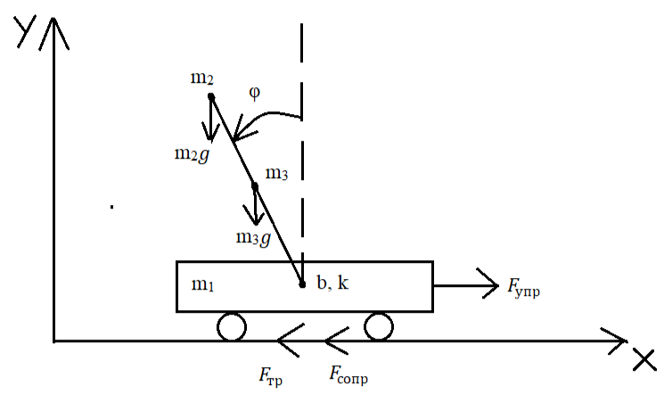

# Перевёрнутый маятник на тележке с ПИД-регулятором

Учебный практикум на ЭВМ, 5 семестр, группа ИУ1-52Б, руководитель Вереникин С.Н. (декабрь 2023).

Задача: построить математическую модель маятника на подвижной опоре, промоделировать её и стабилизировать маятник в вертикальном положении ПИД-регулятором.

- `inverted_pendulum_pid.slx` — модель Simulink (R2022a);
- [report.pdf](report.pdf) — отчёт по практикуму.
